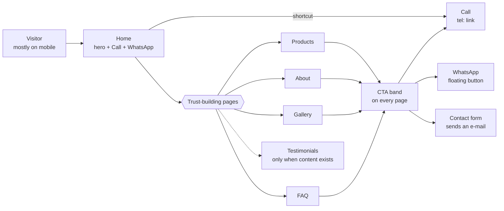
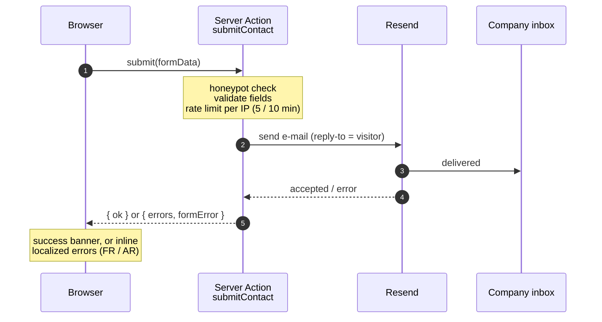
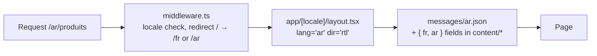
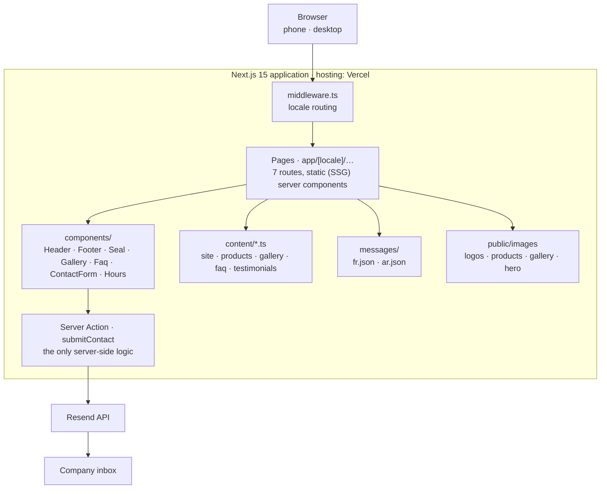
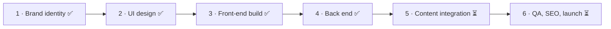

<div align="center">


# LA COLOMBE

**SARL Minoterie Ouled Lamri** · Bordj Bou Arréridj, Algeria

Bilingual showcase website for a flour mill · Next.js · French and Arabic (RTL)

*La farine de Bordj Bou Arréridj, pour ceux qui font le pain chaque jour.*
*دقيق برج بوعريريج، لمن يصنعون الخبز كل يوم.*

</div>

---

## Contents

1. [Overview](#1-overview)
2. [The client](#2-the-client)
3. [Purpose](#3-purpose)
4. [Visitor journey](#4-visitor-journey)
5. [Sitemap and routes](#5-sitemap-and-routes)
6. [Home page anatomy](#6-home-page-anatomy)
7. [Inner pages](#7-inner-pages)
8. [Contact form](#8-contact-form)
9. [Elements on every page](#9-elements-on-every-page)
10. [Languages: French and Arabic](#10-languages-french-and-arabic)
11. [Visual identity and design system](#11-visual-identity-and-design-system)
12. [Motion](#12-motion)
13. [Architecture](#13-architecture)
14. [Content model](#14-content-model)
15. [Back end](#15-back-end)
16. [Quality: SEO, performance, accessibility](#16-quality-seo-performance-accessibility)
17. [Content status and where it plugs in](#17-content-status-and-where-it-plugs-in)
18. [Getting started and deployment](#18-getting-started-and-deployment)
19. [Repository structure](#19-repository-structure)
20. [Open points](#20-open-points)

---

## 1. Overview

| | |
|---|---|
| **7** pages | Home + 6 inner pages (testimonials hidden until reviews exist) |
| **2** languages | French (LTR) · Arabic (RTL) |
| **3** contact channels | Phone · WhatsApp · Form |
| **0** e-commerce | Showcase only |

**In scope:**
- presentation of the company and its flour ranges
- reassurance through the about page, gallery, FAQ and testimonials
- direct contact by phone, WhatsApp or the e-mail form
- French and Arabic, with automatic RTL
- SEO and mobile-first performance

**Out of scope:**
- online shop, cart, payments
- user accounts
- CMS or admin panel (content lives in versioned files)
- Google Business integration (no listing exists)

---

## 2. The client

| Field | Value |
|---|---|
| Company | SARL Minoterie Ouled Lamri |
| Brand | LA COLOMBE (the dove) · Arabic: لاكولومب |
| Sector | Flour milling (*minoterie*) |
| Address | Bir Aissa, Commune Ain Tasserra, Wilaya de Bordj Bou Arréridj |
| Phone / WhatsApp | 0661 37 00 11 → `tel:+213661370011` · `wa.me/213661370011` |
| E-mail | contact.minoterie@ouled-lamri.com |
| Preferred contact | Phone |
| Audience | Bakers, pastry makers, wholesalers, local businesses, households |

**Opening hours** (Algerian week, starting Saturday)

| Day | Hours |
|---|---|
| Saturday – Wednesday | 08:00 – 16:00 |
| Thursday | 08:00 – 12:00 |
| Friday | Closed |

These hours appear in three places:
- **Footer:** the full week, on every page.
- **Contact page:** a table with today's row highlighted, plus a live *open now / closed now* status calculated in Algeria's time zone (`Africa/Algiers`).
- **Structured data:** the `LocalBusiness` data read by search engines.

---

## 3. Purpose

One site, three jobs:

| # | Job | How |
|---|---|---|
| 1 | **Present** | The company, its mill and its flour ranges, clearly and fast |
| 2 | **Reassure** | Story, milling process, values, gallery, FAQ, reviews |
| 3 | **Convert** | Push the visitor to call or write. Phone first |

**Success metric: contact actions.** Every page ends with a way to call, message on WhatsApp, or send the form.

---

## 4. Visitor journey



---

## 5. Sitemap and routes

Every route exists under both locales (`/fr/...` and `/ar/...`). The root `/` redirects to `/fr`, or to `/ar` when the browser prefers Arabic.

| Route | Content | Source |
|---|---|---|
| `/` | Hero with the animated seal, values, product preview, about teaser, gallery preview, CTA band | `messages/*.json`, `content/*` |
| `/a-propos` | Story of the brand name, the 4-step milling process, values, location | `messages/*.json` |
| `/produits` | One block per flour range, image side alternating, sizes, "ask the price" on WhatsApp | `content/products.ts` |
| `/galerie` | Responsive photo grid, lightbox (keyboard ← → Esc) | `content/gallery.ts` |
| `/temoignages` | Review cards. **Returns 404 and is hidden from the menu while empty** | `content/testimonials.ts` |
| `/faq` | Accessible accordion + "another question?" card + FAQ structured data | `content/faq.ts` |
| `/contact` | Phone card, hours, form, e-mail, address, social links, map block | `content/site.ts` |

**Routing rules:**
- Switching language keeps the visitor on the same page.
- Each page has its own title, description, canonical link and `hreflang` alternates.
- `sitemap.xml` and `robots.txt` are generated. Testimonials join the sitemap only once reviews exist.

---

## 6. Home page anatomy

```
┌──────────────────────────────────────────────┐
│ ① Header  logo · nav · FR|ع · call           │
├──────────────────────────────────────────────┤
│ ② Hero    headline · Call · WhatsApp │ seal  │
├──────────────────────────────────────────────┤
│ ③ Values (brown)  Constance · Proximité ·    │
│                    Savoir-faire              │
├──────────────────────────────────────────────┤
│ ④ Products preview   3 cards                 │
├──────────────────────────────────────────────┤
│ ⑤ About teaser       image · text            │
├──────────────────────────────────────────────┤
│ ⑥ Gallery preview    3 tiles                 │
├──────────────────────────────────────────────┤
│ ⑦ Testimonials       (only when not empty)   │
├──────────────────────────────────────────────┤
│ ⑧ CTA band (brown)   phone · WhatsApp        │
├──────────────────────────────────────────────┤
│ ⑨ Footer             links · contact · hours │
└──────────────────────────────────────────────┘
                                      [WhatsApp]
```

| # | Block | Source | Behaviour |
|---|---|---|---|
| 1 | Header | `messages`, `site.ts` | Sticky, language switch, call button, mobile drawer under 1024 px |
| 2 | Hero | `messages` | Headline rises line by line. The brand seal draws itself. Both CTAs above the fold on mobile |
| 3 | Values | `messages` | The 3 brand values from the charter, on a brown band |
| 4 | Products preview | `products.ts` | All ranges as cards, link to `/produits` |
| 5 | About teaser | `messages` | 3:2 image slot + text, link to `/a-propos` |
| 6 | Gallery preview | `gallery.ts` | First 3 items, link to `/galerie` |
| 7 | Testimonials | `testimonials.ts` | Not rendered when the array is empty |
| 8 | CTA band | `site.ts` | Call + WhatsApp, seal watermark |
| 9 | Footer | `site.ts` | Logo, tagline, pages, contact, hours, social |

---

## 7. Inner pages

| Page | Contains | Content status |
|---|---|---|
| **La minoterie** `/a-propos` | Brand story ("why the dove"). Process *Du grain au sac* in 4 numbered steps (reception & cleaning → milling → sifting → control & bagging): on scroll each number fills with gold and a line draws toward the next step. Values, location + "open in Google Maps" | Draft text, to validate |
| **Farines** `/produits` | One block per range: image, use, description, sizes, *ask the price* on WhatsApp with a pre-filled message | **SAMPLE** ranges, list pending |
| **Galerie** `/galerie` | 6 tiles in 3 ratios (16:9, 1:1, 4:3). The lightbox opens only on real photos | Placeholders, photos pending |
| **Témoignages** `/temoignages` | Quote cards | None yet (hidden) |
| **Questions** `/faq` | 5 questions (delivery, minimum order, professionals, prices, pick-up) + call/WhatsApp card | Generic draft |
| **Contact** `/contact` | Aligned 7/5 grid. Row 1: form beside phone + hours. Row 2: map block beside e-mail, address, social. On mobile, phone and hours come first | Ready (map coordinates pending) |

---

## 8. Contact form



| Field | Rule |
|---|---|
| `name` | optional |
| `phone` | **required**, Algerian format: `0`, `+213` or `00213` followed by a mobile (5/6/7 + 8 digits) or landline number |
| `email` | optional, valid format |
| `subject` | select: price request, order, delivery, other question |
| `message` | **required**, at least 10 characters |
| `website` | hidden honeypot. If a bot fills it, the server reports success and sends nothing |

**Failure paths:**
- **Validation error:** an inline message under each wrong field (icon + text, `aria-invalid`), and the visitor's input is kept.
- **Spam:** a silent success, and no e-mail is sent.
- **Too many messages:** a "try again in a few minutes or call us" message.
- **Provider down, or no API key in production:** "Sending failed, call us at 0661 37 00 11". The form never claims a message was sent when it wasn't.
- **Development without a key:** the message is logged in the console and the form reports success.

---

## 9. Elements on every page

| Element | Detail |
|---|---|
| Floating WhatsApp | Fixed at the end corner: bottom-right in French, bottom-left in Arabic. Opens `wa.me/213661370011` with a pre-filled greeting |
| Language switcher | Pill `FR \| ع` with a sliding indicator. Same page in the other language, and updates `lang` + `dir` |
| Click-to-call | Every phone number is a `tel:+213661370011` link |
| Mobile drawer | Brown full-width panel. Links appear one after another, with Call + WhatsApp at the bottom. Focus stays inside it, Escape closes it, and the page behind doesn't scroll |
| CTA band | Brown band with the phone number and WhatsApp before the footer |
| Footer | Logo, tagline, pages, phone, WhatsApp, e-mail, address, hours, Facebook, Instagram |
| Skip link | "Aller au contenu" for keyboard users |

---

## 10. Languages: French and Arabic



- **Built-in i18n:** no extra library. `i18n/config.ts` loads `messages/fr.json` or `messages/ar.json`; both have the same keys, so TypeScript catches any missing string.
- **Logical CSS only:** `ms-*`, `me-*`, `ps-*`, `start-*`, `end-*` and `text-start`; no left or right offsets.
- **What mirrors:** directional icons (arrows, chevrons) mirror. Logos, the seal, maps and phone numbers never do.
- **Numbers stay left-to-right:** phone numbers, e-mails and time ranges are isolated (`.ltr`, Unicode isolates) so they never reverse inside Arabic text.
- **Arabic typography:** IBM Plex Sans Arabic with its own size scale. No letter spacing and no uppercase.
- **Logotype:** "LA COLOMBE" stays in Latin capitals on Arabic pages, as in the charter.

---

## 11. Visual identity and design system

Sources:
- `02-website/system and brand design and guidlines/La Colombe Brand Guidelines`: the official charter.
- `…/La Colombe system design`: the component and token system.

The charter's values override the provisional ones from the design system. The design system was built before the logo existed.

### Palette (60 / 30 / 10)

| Token | Hex | Use |
|---|---|---|
| Crème | `#F4ECDD` | Page background (60 %) |
| Brun meunier | `#3A2516` | Text, brown bands, buttons, footer (30 %) |
| Or blé | `#B5893E` | Accents, rules, fills, icons (10 %). Never running text on cream |
| Or profond | `#8A6524` | Gold-family text on cream (4.5:1) |
| Or doux | `#DCC08C` | Gold text on brown |
| WhatsApp | `#25D366` | WhatsApp buttons only, dark-green text |

### Typography

| Role | Typeface |
|---|---|
| Headings (Latin) | **Cormorant Garamond** 500/600/700, with an italic gold accent in the hero |
| Body (Latin) | **Jost** 400/500/600 |
| Arabic (all) | **IBM Plex Sans Arabic** 400–700. The charter specifies Amiri; it was replaced after review with a more modern, simpler face |
| Logotype | Cormorant capitals, wide tracking, on both languages |

### Rules kept from the charter and design system
- **Logo:** the official symbol is used unchanged. It is never rotated, recolored or given effects.
- **Signature element:** the circular seal from charter page 04 (double gold rule, 180-pearl crown, name along the ring).
- **Image placeholders:** the logo as a still 18 % watermark on cream, at fixed ratios (product 4:3, about 3:2, gallery 1:1, 4:3 and 16:9). Adding the image path swaps in the photo with no layout shift.
- **Spacing and shape:** 4 px spacing base, 16 px card radius, 48–56 px buttons, 44 px minimum tap targets.
- **Restraint:** no gradients, no heavy shadows, no emoji, no exclamation marks, no unverifiable claims.

---

## 12. Motion

One orchestrated moment on load, then quiet reveals as you scroll. **Nothing loops**, and everything stops under `prefers-reduced-motion`.

| Where | Animation |
|---|---|
| Hero | Headline lines rise from under a baseline mask, then the lead text, CTAs and hours fade in |
| Seal | The rings trace themselves, the pearls appear, letters set one by one along the ring, then the dove settles (≈ 2 s, once) |
| Sections | Fade-up of 18 px, once, when entering the viewport (staggered in grids) |
| Process steps | The number fills with gold, then a connector line draws toward the next step |
| Cards | Lift 4 px with a soft shadow and a gold border on hover (pointer devices only) |
| Links | Underline grows, arrow nudges forward (mirrored in RTL) |
| Header nav | Gold underline slides in. The language pill indicator slides between FR and ع |
| FAQ | Panel height animates, the `+` rotates into `×` |
| Mobile drawer | Links come in one after another |
| WhatsApp button | Enters after the hero has settled |
| Buttons | Press feedback: `translateY(1px) scale(.98)` |

---

## 13. Architecture



| Layer | Choice |
|---|---|
| Framework | Next.js 15.5 (App Router), React 19, TypeScript (strict) |
| Styling | Tailwind CSS 3.4 + CSS variables (tokens in `app/globals.css`) |
| Fonts | `next/font/google`: self-hosted, `display: swap` |
| Images | `next/image`, AVIF/WebP |
| i18n | Built-in dictionaries + middleware |
| Form | Server Action + `useActionState`, Resend REST API |
| Rendering | All pages pre-rendered at build time |

---

## 14. Content model

```ts
// i18n/config.ts
type L10n = { fr: string; ar: string };

// content/products.ts: SAMPLE until the client sends the real list
type Product = {
  id: string;
  name: L10n;
  use: L10n;           // bread, pastry, home cooking…
  description: L10n;
  sizes: string[];     // ['25 kg', '50 kg']
  image?: string;      // empty → logo placeholder
};

// content/gallery.ts
type GalleryItem = { id: string; caption: L10n; ratio: 'sq' | 'g43' | 'wide'; image?: string };

// content/testimonials.ts: empty array → band, page and menu entry hidden
type Testimonial = { quote: L10n; name: string; role: L10n };

// content/faq.ts
type Faq = { q: L10n; a: L10n };

// content/site.ts: single source for header, footer, contact page, structured data
export const site = {
  company, brand, phoneDisplay, phoneIntl, whatsapp, email,
  address: L10n,
  coordinates: null,          // pending → map block shows address + Google Maps link
  social: { facebook, instagram },
  hours: { [day]: ['08:00', '16:00'] | null },
  timezone: 'Africa/Algiers',
};
```

**Principles:**
- Page copy lives in `content/*.ts`; interface strings live in `messages/*.json`.
- Components hold no copy. They receive typed props.
- Replacing a placeholder never changes a component.
- Empty collections hide their section automatically.

---

## 15. Back end

| # | Module | Implementation |
|---|---|---|
| 1 | Contact action | `app/actions/contact.ts` → `submitContact` (Server Action) |
| 2 | Validation | Server side: trim, length caps, Algerian phone regex, e-mail format, message length |
| 3 | Anti-spam | Honeypot field + in-memory rate limit (5 messages / 10 min / IP) |
| 4 | E-mail delivery | Resend REST API to the company inbox, `reply_to` set to the visitor |
| 5 | Localized responses | Returns message keys; the UI translates them in FR / AR |
| 6 | Configuration | Environment variables only, nothing secret in the repo |
| 7 | SEO routes | `app/sitemap.ts`, `app/robots.ts`, `hreflang` alternates |

```ts
// contract with the front end
type ContactState = {
  ok: boolean | null;
  errors?: Partial<Record<'name' | 'phone' | 'email' | 'subject' | 'message',
                          'required' | 'phone' | 'email' | 'short'>>;
  formError?: 'form' | 'rate' | 'delivery';
  values?: Partial<Record<Field, string>>;   // keeps what the visitor typed
};
```

```bash
# .env.local (see .env.example)
RESEND_API_KEY=                 # required in production
CONTACT_TO_EMAIL=contact.minoterie@ouled-lamri.com
CONTACT_FROM_EMAIL=             # sender on a domain verified in Resend
NEXT_PUBLIC_SITE_URL=           # production URL, used by sitemap / canonical links
```

---

## 16. Quality: SEO, performance, accessibility

**Core Web Vitals targets (mid-range phone):** LCP ≤ 2.5 s · INP ≤ 200 ms · CLS ≤ 0.1

**SEO:**
- [x] Title and description in FR and AR, targeting "minoterie Bordj Bou Arréridj"
- [x] `sitemap.xml`, `robots.txt`, canonical links and `hreflang` alternates
- [x] `LocalBusiness` structured data (address, phone, opening hours) and `FAQPage` data
- [x] Static pre-rendering, fonts self-hosted through `next/font`, images through `next/image`

**Layout and accessibility:**
- [x] Mobile-first. Checked with no horizontal scroll from 320 px on all routes, in both languages
- [x] Accessibility:
  - visible 3 px focus ring on every interactive element
  - 44 px tap targets
  - labelled form fields with `aria-invalid` and `aria-describedby`
  - skip link
  - accessible accordion and dialog
  - contrast checked against the charter's pairs
  - reduced-motion support

**Still to run before launch:**
- [ ] Lighthouse audit (mobile performance ≥ 90, accessibility ≥ 95)

---

## 17. Content status and where it plugs in

| Item | Status | Plugs into |
|---|---|---|
| Logo | ✅ Received | `public/images/logo-{brown,cream,gold}.svg` |
| Colors and charter | ✅ Applied | `app/globals.css` → `:root` tokens |
| Presentation texts | 🟡 Draft written | `messages/*.json` (`home`, `about`) |
| Flour ranges | 🔴 Sample data | `content/products.ts` |
| Product photos | 🔴 Placeholders | `public/images/products/` + `image` field |
| Gallery photos | 🔴 Placeholders | `public/images/gallery/` + `content/gallery.ts` |
| Testimonials | 🔴 None (hidden) | `content/testimonials.ts` |
| FAQ answers | 🟡 Generic draft | `content/faq.ts` |
| Map coordinates | 🔴 Not provided | `content/site.ts` → `coordinates` |
| Facebook / Instagram URLs | 🔴 Not provided | `content/site.ts` → `social` |
| E-mail sending | 🔴 Key needed | `RESEND_API_KEY` |

When an asset arrives, it is a **file swap with no code change**. For example, to add a photo:

```ts
{ id: 'farine-boulangere', /* … */ image: '/images/products/farine-boulangere.jpg' }
```

---

## 18. Getting started and deployment

**Requirements:** Node.js 18.18+ (developed on Node 24).

```bash
cd 02-website/minoterie-ouled-lamri
npm install
cp .env.example .env.local        # fill in the values
npm run dev                       # http://localhost:3000
```

```bash
npm run build                     # type-check + static build
npm start                         # production server
```

**Deploy on Vercel:**
1. Import the repository.
2. Set **Root Directory** to `02-website/minoterie-ouled-lamri`.
3. Add the environment variables from `.env.example`.
4. Verify the sender domain in Resend and set `CONTACT_FROM_EMAIL`.
5. Point the production domain and set `NEXT_PUBLIC_SITE_URL`.

---

## 19. Repository structure

```
.
├─ 01-brand/                         brand brief, logo source files
├─ 02-website/
│  ├─ 01-website-spec.md             functional specification
│  ├─ 02-ui-frontend-brief.md        UI direction and front-end brief
│  ├─ 03-content-tracker.md          client content checklist
│  ├─ system and brand design and guidlines/
│  │  ├─ La Colombe Brand Guidelines/   official charter (HTML deck + logos)
│  │  └─ La Colombe system design/      tokens, components, RTL, a11y docs
│  └─ minoterie-ouled-lamri/         ← the Next.js website
│     ├─ app/
│     │  ├─ [locale]/                layout + 7 routes + not-found
│     │  ├─ actions/contact.ts       Server Action
│     │  ├─ globals.css              tokens, components, motion
│     │  ├─ sitemap.ts · robots.ts
│     ├─ components/                 Header, Footer, Logo, Seal, Icon, Reveal,
│     │                              Blocks, ProductCard, Gallery, Faq,
│     │                              ContactForm, Hours
│     ├─ content/                    site, products, gallery, faq, testimonials
│     ├─ i18n/                       config, nav, meta
│     ├─ messages/                   fr.json, ar.json
│     ├─ public/images/              logos + products/ gallery/ hero/
│     ├─ middleware.ts               locale redirect
│     └─ tailwind.config.ts
├─ 03-presentation/presentation.html technical briefing deck (18 slides)
└─ cahier-des-charges-minoterie-ouled-lamri.md
```

---

## 20. Open points

**To settle with the client:**
- Real flour range list, sizes and photos
- 10–20 photos of the mill, production and sacks
- GPS coordinates, and Facebook / Instagram URLs
- Two or three customer quotes, with permission to publish them
- FAQ answers validated
- Sender domain for outgoing e-mail, production domain and hosting account

**Delivery sequence:**



---

<div align="center">

**LA COLOMBE** · SARL Minoterie Ouled Lamri · Bordj Bou Arréridj

</div>
